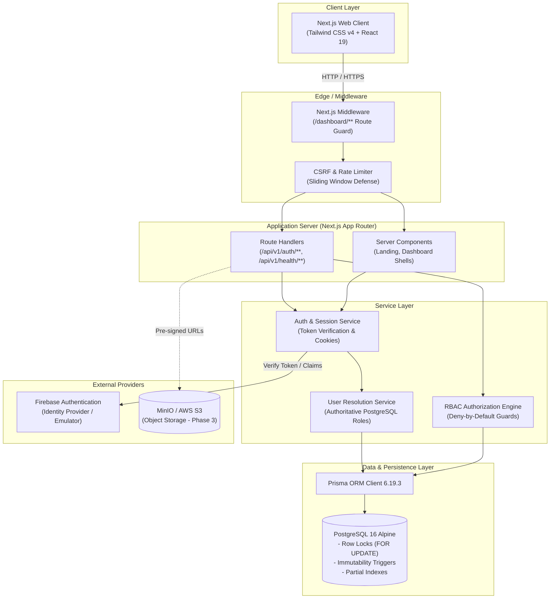

# LeaveFlow — Employee Leave Management System

An enterprise-grade employee leave management system engineered for high-concurrency environments, multi-tier approvals, and compliance-driven auditability. Built on Next.js App Router, PostgreSQL 16, Prisma ORM, and Firebase Authentication.

---

## Table of Contents

1. [Quick Start & Setup Guide](#1-quick-start--setup-guide)
   - [Prerequisites](#prerequisites)
   - [Environment Configuration (.env via Google Drive)](#environment-configuration-env-via-google-drive)
   - [Option 1: Clone Repository & Setup (Recommended)](#option-1-clone-repository--setup-recommended)
   - [Option 2: Running from ZIP / Offline Package](#option-2-running-from-zip--offline-package)
   - [Option 3: Full-Stack Docker Compose Startup](#option-3-full-stack-docker-compose-startup)
   - [Demo Account Credentials](#demo-account-credentials)
   - [Running Verification & Tests](#running-verification--tests)
2. [System Architecture](#2-system-architecture)
   - [Architecture Diagram](#architecture-diagram)
   - [Modular Monolith Structure](#modular-monolith-structure)
   - [10-State Workflow Engine](#10-state-workflow-engine)
   - [Security & Concurrency Design](#security--concurrency-design)
3. [Technology Stack](#3-technology-stack)
4. [Future Upgrades & Roadmap](#4-future-upgrades--roadmap)

---

## 1. Quick Start & Setup Guide

### Prerequisites

Ensure you have the following installed on your machine:
- **Git**: For cloning the repository
- **Node.js**: `v20.x` or `v22.x` LTS
- **npm**: `v10.x` or higher
- **PostgreSQL 16**: Either running natively on port `5432` OR via **Docker Desktop**

---

### Environment Configuration (.env via Google Drive)

> [!IMPORTANT]
> **Production `.env` Shared via Google Drive**:
> To safeguard cloud service credentials while ensuring a seamless evaluation experience, the production `.env` file containing verified Firebase Cloud project keys, Firebase Admin configuration, and database connection strings **will be shared separately in the Google Drive submission folder**.
>
> 1. Download the `.env` file from the Google Drive link.
> 2. Place it directly in the root directory of the application:
>    ```text
>    employee_leave_management/
>    ├── .env           <-- Place downloaded file here
>    ├── .env.example   <-- Reference template
>    ├── package.json
>    └── ...
>    ```
> *(If you do not have the Drive file, you can copy `.env.example` to `.env` and fill in your local PostgreSQL credentials.)*

---

### Option 1: Clone Repository & Setup (Recommended)

#### 1. Clone the GitHub Repository
```bash
git clone https://github.com/Vishnu-b-k/employee_leave_management.git
cd employee_leave_management
```

#### 2. Add the `.env` File
Copy the provided `.env` file from Google Drive into the project root directory.

#### 3. Install Dependencies
```bash
npm install
```

#### 4. Setup Database & Migrations
Ensure PostgreSQL 16 is running, then generate the Prisma client and apply database migrations (creates 12 entities, partial indexes, check constraints, and immutability triggers):

```bash
# Generate Prisma Client types
npm run prisma:generate

# Apply database migration
npm run prisma:migrate
```

#### 5. Seed Demo Accounts & Initial Data
Run the automated, idempotent seed utility to initialize the organizational hierarchy (Engineering Department), demo users (Employee, Manager, HOD), role assignments, and leave types:

```bash
npm run seed:auth
```

#### 6. Start the Development Server
```bash
npm run dev
```
Open **[http://localhost:3000](http://localhost:3000)** in your browser.

---

### Option 2: Running from ZIP / Offline Package

If evaluating from the submitted ZIP archive:

1. Extract the ZIP archive onto your local filesystem.
2. Open a terminal inside the extracted project directory (`cd application`).
3. Place the `.env` file from the Google Drive submission folder into the project root.
4. Run:
   ```bash
   npm install
   npm run prisma:generate
   npm run prisma:migrate
   npm run seed:auth
   npm run dev
   ```
5. Open **[http://localhost:3000](http://localhost:3000)**.

---

### Option 3: Full-Stack Docker Compose Startup

To run the entire multi-service stack (PostgreSQL 16 Alpine + Prisma Migration Runner + Next.js App) with a single command without installing PostgreSQL locally:

1. Ensure **Docker Desktop** is running.
2. Place the `.env` file into the root directory.
3. Run:
```bash
docker compose up --build
```

Docker Compose orchestrates:
- `postgres`: PostgreSQL 16 Alpine with persistent volume `pgdata` on internal port `5432` with automated health check.
- `prisma-migrate`: One-shot migration container that applies all PostgreSQL migrations as soon as PostgreSQL reports healthy.
- `app`: Production multi-stage Next.js container on port `3000`, starting after migrations finish.

Open **[http://localhost:3000](http://localhost:3000)** once the containers are running.

---

### Demo Account Credentials

The seed script provisions 3 pre-configured demo users in both Firebase Auth and PostgreSQL. These can also be populated with 1-click buttons on the `/login` screen:

| Role | Email | Password | Scope & Responsibilities |
|---|---|---|---|
| **Employee** | `employee@leaveflow.internal` | `EmployeePass123!` | Submits personal leave requests, views own history, files appeals. |
| **Manager** | `manager@leaveflow.internal` | `ManagerPass123!` | Reviews requests for assigned direct reports (DR-01). Reports to HOD (DR-10). |
| **HOD** | `hod@leaveflow.internal` | `HodPass123!` | Final reviewer for long leave (>3 days) and employee appeals. |

---

### Running Verification & Tests

```bash
# Run the 31-test Automated RBAC & Auth Verification Suite
npm run test:auth

# Check Database Migration Status
npm run prisma:status

# Validate Next.js Production Build
npm run build
```

#### System Health Check Probes
- **Liveness probe:** `GET http://localhost:3000/api/v1/health/live` (Checks node process uptime)
- **Readiness probe:** `GET http://localhost:3000/api/v1/health/ready` (Probes live PostgreSQL query latency)

---

## 2. System Architecture

LeaveFlow is built as a **modular monolith** with clean boundary separation between HTTP routing, business logic, authorization guards, and database persistence.

### Architecture Diagram



---

### Modular Monolith Structure

```
src/
├── app/                      # Next.js App Router
│   ├── api/v1/               # Versioned REST API Route Handlers
│   │   ├── auth/             # Login, Logout, Session (/me)
│   │   └── health/           # Liveness (/live) and Readiness (/ready)
│   ├── dashboard/            # Authenticated role-aware dashboard shells
│   │   ├── employee/         # Employee leave request view
│   │   ├── manager/          # Manager approvals queue (DR-01 scope)
│   │   └── hod/              # HOD department review & appeals
│   ├── login/                # Sign-in page with demo account quick-fill
│   ├── unauthorized/         # 403 Forbidden state page
│   ├── layout.tsx            # Global layout with AuthProvider & Geist font
│   └── page.tsx              # Public architecture & landing view
├── components/               # Shared reusable UI components
│   └── dashboard/            # Role-aware navigation tabs & headers
├── modules/                  # Encapsulated Domain Modules
│   ├── auth/                 # Auth hooks, context & re-exports
│   ├── users/                # User resolution & reporting hierarchies
│   ├── leave/                # Leave domain calculations (Phase 3)
│   ├── approvals/            # Approval workflow handlers (Phase 3)
│   ├── appeals/              # Appeals review domain (Phase 3)
│   ├── documents/            # Document storage metadata (Phase 3)
│   ├── notifications/        # In-app notifications domain (Phase 3)
│   └── audit/                # Audit logging domain (Phase 3)
├── lib/                      # Core infrastructure utilities
│   ├── auth/                 # RBAC engine, session resolution, CSRF, rate limiter
│   ├── firebase/             # Client SDK & Admin SDK initializers
│   ├── prisma.ts             # Singleton PrismaClient instance
│   └── seed/                 # Repeatable demo account seeding logic
├── types/                    # Shared TypeScript domain models & API responses
├── prisma/
│   ├── schema.prisma         # 12-entity 3NF relational data model
│   └── migrations/           # Versioned SQL migration files
└── scripts/                  # Standalone CLI tools (seed-auth, test-auth-rbac)
```

---

### 10-State Workflow Engine

The leave request lifecycle implements the following formal finite state machine:

```
[Draft Submission]
       │
       ▼
 PENDING_MANAGER ──(Request Info)──► INFO_REQUESTED
       │     ▲                             │
       │     └──────(Resubmit Info)────────┘
       │
       ├─────────────────────────────────┐
       ▼ (Approve <= 3 days)             ▼ (Approve > 3 days)
   APPROVED                         PENDING_HOD
                                         │
                         ┌───────────────┴───────────────┐
                         ▼ (HOD Approve)                 ▼ (HOD Reject)
                     APPROVED                    REJECTED_BY_HOD [Terminal]
       │
       ▼ (Manager Reject)
 REJECTED_BY_MANAGER ──(Employee Appeal)──► UNDER_APPEAL
                                                 │
                                 ┌───────────────┴───────────────┐
                                 ▼ (HOD Overturns)               ▼ (HOD Upholds)
                         APPROVED_ON_APPEAL [Terminal]    APPEAL_REJECTED [Terminal]

 * Employee may CANCEL while in PENDING_MANAGER state (transitions to CANCELLED [Terminal]).
```

---

### Security & Concurrency Design

1. **Optimistic Concurrency Control:**
   - Every `leave_requests` record includes a `version` integer column.
   - All state transitions use explicit transactions with `SELECT ... FOR UPDATE` row locks.
   - Concurrent updates are rejected with `HTTP 409 Conflict`, completely preventing double approvals.

2. **Database-Level Immutability:**
   - `audit_logs` and `decisions` records are append-only.
   - Enforced by PostgreSQL triggers (`trg_audit_logs_immutable`, `trg_decisions_immutable`) that abort any `UPDATE` or `DELETE` regardless of user role, even if invoked by the table owner.
   - Runtime application user `app_user` operates with least privilege (`GRANT SELECT, INSERT` only).

3. **Multi-Role & Scope Enforcement:**
   - Roles are stored in the `user_roles` join table, allowing users to hold both `EMPLOYEE` and `MANAGER` roles simultaneously.
   - **DR-01 Scope:** Managers can view and approve requests only from employees assigned to them via `manager_id`.
   - **DR-10 Rule:** A Manager's own leave requests route to the HOD (`manager.manager_id = hod.id`).
   - **No Self-Approval:** Server-side authorization blocks users from approving their own submissions.

4. **Session & Transport Security:**
   - Secure HTTP-only cookies (`leaveflow_session`) verified via Firebase Admin SDK.
   - In-memory sliding-window rate limiting on login routes.
   - CSRF validation comparing custom header against cookie for all mutations.

---

## 3. Technology Stack

| Layer | Technology | Version | Purpose & Rationale |
|---|---|---|---|
| **Frontend Framework** | Next.js (App Router) | `16.4.5` | React Server Components, server actions, dynamic routing, and fast SSR. |
| **UI Library** | React | `19.3.0` | Modern component architecture, hooks, and Suspense boundaries. |
| **Styling** | Tailwind CSS | `v4.x` | Modern utility-first CSS with custom design tokens. |
| **Language** | TypeScript | `v5.x` | End-to-end type safety between frontend, backend, and database models. |
| **Database** | PostgreSQL | `16 Alpine` | ACID transactions, row-level locking, partial indexes, and JSONB metadata. |
| **ORM** | Prisma ORM | `6.19.3` | Type-safe query building, relational modeling, and SQL migration management. |
| **Authentication** | Firebase Auth | `13.x / 14.x` | Client SDK & Admin SDK for identity, with local Emulator support. |
| **Validation** | Zod | `3.x / 4.x` | Schema-based request payload validation and sanitization. |
| **Containerization** | Docker & Compose | `v29+` | Reproducible development, testing, and assessment environments. |

---

## 4. Future Upgrades & Roadmap

### Phase 3: Leave Submission & Document Management (Upcoming)
- **Working-Days Calculation Engine:** Automated server-side computation excluding weekends and configured company holidays (`holidays` table).
- **S3-Compatible Document Storage:** Integration with MinIO / AWS S3 using AWS SDK v3. Opaque UUID keys, client pre-signed URLs, and server-side MIME type verification.
- **Leave Balance Ledger:** Formal entitlement and balance tracking (`leave_balances` table) supporting annual carryovers and warning modes (DR-13).

### Phase 4: Workflow Execution & Notification Engine
- **Atomic Transition Pipeline:** Transaction wrapper coordinating status updates, decision history insertion, audit logging, and in-app notifications in a single database transaction.
- **Transactional In-App Notifications:** Real-time notification feed for approval events, info requests, and appeal outcomes.
- **Email Notification Fallbacks:** Asynchronous email dispatch (via Resend or AWS SES) designed to fail gracefully without blocking workflow state transitions.

### Phase 5: Enterprise Enhancements & Scale
- **Temporary Manager Delegation:** Delegated approval rights to a peer manager when a manager is on leave.
- **Departmental Analytics & Absence Heatmaps:** Team capacity planning, seasonal leave trends, and exportable iCal / Google Calendar feeds.
- **Enterprise SSO Integration:** SAML 2.0 / OIDC enterprise identity federation (Okta, Azure AD, Google Workspace) via Firebase Identity Platform.
- **Cryptographic Audit Log Verification:** Merkle-tree verification for exported compliance logs.

---

*LeaveFlow — Enterprise Leave Management System Architecture & Implementation Documentation*
