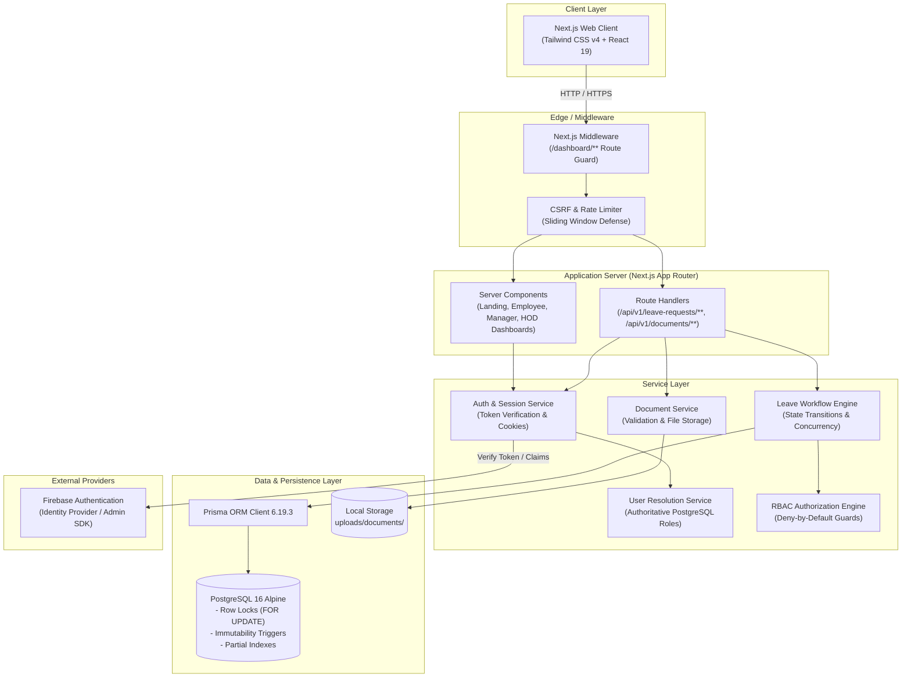

# LeaveFlow — Employee Leave Management System

An enterprise-grade employee leave management system engineered for high-concurrency environments, multi-tier approvals, robust document verification, and compliance-driven auditability. Built on Next.js 16 App Router, PostgreSQL 16, Prisma ORM, and Firebase Authentication.

---

## Table of Contents

1. [Quick Start & Setup Guide](#1-quick-start--setup-guide)
   - [Prerequisites](#prerequisites)
   - [Environment Configuration (.env)](#environment-configuration-env)
   - [Option 1: Full-Stack Docker Compose Startup (Recommended)](#option-1-full-stack-docker-compose-startup-recommended)
   - [Option 2: Local Development Setup](#option-2-local-development-setup)
   - [Demo Account Credentials](#demo-account-credentials)
2. [Verified Workflows & Features](#2-verified-workflows--features)
   - [10-State Workflow Engine](#10-state-workflow-engine)
   - [Leave Request Submission & Working-Days Calculation](#leave-request-submission--working-days-calculation)
   - [Multi-Tier Approval Pipeline (Manager & HOD)](#multi-tier-approval-pipeline-manager--hod)
   - [Rejection Appeals Workflow](#rejection-appeals-workflow)
   - [Information Requests & Resubmission](#information-requests--resubmission)
   - [Application Cancellation](#application-cancellation)
   - [Secure Document Management](#secure-document-management)
   - [Transactional In-App Notifications](#transactional-in-app-notifications)
   - [Optimistic Concurrency & Double-Approval Protection](#optimistic-concurrency--double-approval-protection)
3. [System Architecture](#3-system-architecture)
   - [Architecture Diagram](#architecture-diagram)
   - [Modular Monolith Directory Layout](#modular-monolith-directory-layout)
   - [Relational Data Model & PostgreSQL Triggers](#relational-data-model--postgresql-triggers)
4. [API Endpoints Reference](#4-api-endpoints-reference)
5. [Technology Stack](#5-technology-stack)
6. [Testing & Verification](#6-testing--verification)

---

## 1. Quick Start & Setup Guide

### Prerequisites

Ensure you have the following installed on your machine:
- **Docker Desktop** (recommended for 1-command startup) OR
- **Node.js**: `v20.x` or `v22.x` LTS
- **npm**: `v10.x` or higher
- **PostgreSQL 16**: Port `5432`

---

### Environment Configuration (.env)

> [!IMPORTANT]
> **Production `.env` Configuration**:
> To safeguard cloud service credentials while ensuring an effortless evaluation experience, the production `.env` file containing verified Firebase Cloud project keys, Firebase Admin configuration, and database connection strings is shared in the Google Drive submission package.
>
> 1. Place the `.env` file directly in the application root directory:
>    ```text
>    application/
>    ├── .env           <-- Place downloaded file here
>    ├── .env.example   <-- Reference template
>    ├── package.json
>    └── ...
>    ```
> *(If evaluating locally without Drive keys, `.env.example` provides the baseline schema for local PostgreSQL and Firebase emulator.)*

---

### Option 1: Full-Stack Docker Compose Startup (Recommended)

To run the entire multi-service stack (PostgreSQL 16 Alpine + Prisma Migration Runner + Next.js App) with persistent storage:

1. Ensure **Docker Desktop** is running.
2. Place the `.env` file into the root directory.
3. Run:
```bash
docker compose up --build
```

Docker Compose orchestrates:
- `postgres`: PostgreSQL 16 Alpine with persistent volume `pgdata` on port `5432` with automated health checks.
- `prisma-migrate`: One-shot container that executes `prisma migrate deploy` as soon as PostgreSQL is healthy.
- `app`: Multi-stage production container running Next.js on port `3000` with volume `uploads_data:/app/uploads` for persistent document storage.

Open **[http://localhost:3000](http://localhost:3000)** in your browser.

---

### Option 2: Local Development Setup

If running directly on host machine with local PostgreSQL:

```bash
# 1. Install dependencies
npm install

# 2. Generate Prisma Client
npm run prisma:generate

# 3. Apply database migrations (creates tables, partial indexes, and immutability triggers)
npm run prisma:migrate

# 4. Seed demo users, reporting lines, and leave types
npm run seed:auth

# 5. Start development server
npm run dev
```

Open **[http://localhost:3000](http://localhost:3000)**.

---

### Demo Account Credentials

The database seed script provisions 3 pre-configured demo users in both Firebase Auth and PostgreSQL. Quick-fill buttons are also available directly on the `/login` screen:

| Role | Email | Password | Scope & Responsibilities |
|---|---|---|---|
| **Employee** | `employee@leaveflow.internal` | `EmployeePass123!` | Submits leave requests, uploads certificates, tracks history, resubmits info, files appeals, cancels pending requests. |
| **Manager** | `manager@leaveflow.internal` | `ManagerPass123!` | Reviews requests for assigned direct reports (DR-01). Approves short leaves directly ($\le 3$ days), escalates long leaves to HOD ($> 3$ days), requests clarification, or rejects with comments. Cannot self-approve (DR-10). |
| **HOD** | `hod@leaveflow.internal` | `HodPass123!` | Final authority for department long leaves ($> 3$ days) and employee appeals against manager rejections. |

---

## 2. Verified Workflows & Features

### 10-State Workflow Engine

The leave request lifecycle implements a strict finite state machine:

```
[Draft Submission]
       │
       ▼
 PENDING_MANAGER ──(Request Info)──► INFO_REQUESTED
       │     ▲                             │
       │     └──────(Resubmit Info)────────┘
       │
       ├─────────────────────────────────┐
       ▼ (Approve <= 3 days)             ▼ (Approve > 3 days)
   APPROVED                         PENDING_HOD
                                         │
                         ┌───────────────┴───────────────┐
                         ▼ (HOD Approve)                 ▼ (HOD Reject)
                     APPROVED                    REJECTED_BY_HOD [Terminal]
       │
       ▼ (Manager Reject)
 REJECTED_BY_MANAGER ──(Employee Appeal)──► UNDER_APPEAL
                                                 │
                                 ┌───────────────┴───────────────┐
                                 ▼ (HOD Overturns)               ▼ (HOD Upholds)
                         APPROVED_ON_APPEAL [Terminal]    APPEAL_REJECTED [Terminal]

 * Employee may CANCEL while in PENDING_MANAGER state (transitions to CANCELLED [Terminal]).
```

### Leave Request Submission & Working-Days Calculation
- **Server-Side Date Validation:** Enforces `startDate <= endDate` and prevents past/invalid date submissions.
- **Accurate Working-Days Computation:** Server-side engine calculates business days excluding Saturdays, Sundays, and public holidays configured in the PostgreSQL `holidays` table.
- **Mandatory Documentation for Long Leaves:** Leave requests exceeding **3 working days** require at least one supporting document (e.g., medical certificate, summons). Requests without attachments fail validation immediately with HTTP 400 (`DOCUMENT_REQUIRED`).

### Multi-Tier Approval Pipeline (Manager & HOD)
- **Short Leaves ($\le 3$ Working Days):** Manager approval immediately transitions status from `PENDING_MANAGER` to `APPROVED`.
- **Long Leaves ($> 3$ Working Days):** Manager approval endorses the request and escalates it to `PENDING_HOD`. The Department Head must review and issue the final determination (`APPROVED` or `REJECTED_BY_HOD`).
- **Direct Reports Scoping (DR-01):** Managers can only view and act on direct reports assigned via `user.manager_id`. Attempts to review unauthorized employees fail with HTTP 403.
- **Strict Self-Approval Prevention (DR-10):** Managers cannot approve their own leave submissions (HTTP 403 `FORBIDDEN_SELF_APPROVAL`). Their requests route directly to the Department HOD.

### Rejection Appeals Workflow
- When a manager rejects a leave request (`REJECTED_BY_MANAGER`), the employee can submit an official appeal with justification.
- The request transitions to `UNDER_APPEAL` and is routed to the HOD's review queue.
- The original manager rejection decision and remarks are immutably preserved in the audit trail.
- HOD can either **Overturn** the rejection (`APPROVED_ON_APPEAL`) or **Uphold** the rejection (`APPEAL_REJECTED`).

### Information Requests & Resubmission
- Managers can set a request to `INFO_REQUESTED` with specific questions or requests for supplemental proof.
- The employee dashboard displays an interactive response banner allowing the employee to reply with comments and upload additional documents.
- Resubmitting returns the request to `PENDING_MANAGER` review.

### Application Cancellation
- Employees can cancel their application at any time while it remains in `PENDING_MANAGER` status.
- Once cancelled (`CANCELLED`), subsequent modifications are prevented with HTTP 409 (`INVALID_STATE_TRANSITION`).

### Secure Document Management
- **Storage Isolation:** Files are saved on the server filesystem (`uploads/documents/`) outside the public web root.
- **Strict Validation:** Files are validated on the server for permitted extensions (`.pdf`, `.png`, `.jpg`, `.jpeg`, `.docx`), whitelisted MIME types, and a 10MB size ceiling.
- **Path Traversal Protection:** Unique UUID filenames decouple the filesystem key from user-supplied filenames.
- **Authorized Download Stream:** `GET /api/v1/documents/[id]` guards document access using `RBAC.canAccessLeaveRequest`. Cross-employee access attempts return HTTP 403.

### Transactional In-App Notifications
- Every workflow action atomically inserts a notification record in PostgreSQL for the relevant stakeholder (Employee, Manager, or HOD).
- Real-time notification badge and dropdown in the dashboard shell.
- Notification endpoints support fetching unread counts, reading all notifications, or marking individual items as read.

### Optimistic Concurrency & Double-Approval Protection
- Every `leave_requests` record includes a `version` integer column.
- Workflow mutations require the client's current version number.
- Any concurrent action that modifies the request increments the version; outdated submissions fail with HTTP 409 (`CONCURRENCY_CONFLICT`), completely eliminating double approvals.

---

## 3. System Architecture

### Architecture Diagram



### Modular Monolith Directory Layout

```
src/
├── app/                          # Next.js App Router
│   ├── api/v1/                   # Versioned REST API Route Handlers
│   │   ├── auth/                 # Login, Logout, Session (/me)
│   │   ├── leave-requests/       # Employee submissions, details, appeals, cancellation, resubmission
│   │   ├── manager/              # Manager review queue & decision handlers
│   │   ├── hod/                  # HOD long-leave & appeals review handlers
│   │   ├── documents/            # Secure upload and stream retrieval
│   │   ├── notifications/        # In-app notification feeds & read markers
│   │   ├── leave-types/          # Active leave categories
│   │   └── health/               # Liveness (/live) and Readiness (/ready)
│   ├── dashboard/                # Role-aware dashboard pages
│   │   ├── employee/             # Employee leave application & history
│   │   ├── manager/              # Direct reports approval queue
│   │   └── hod/                  # Department long-leave & appeals queue
│   ├── login/                    # Official sign-in page with 1-click demo accounts
│   ├── layout.tsx                # Global layout with AuthProvider & typography
│   └── page.tsx                  # Official Organization Employee Portal landing page
├── components/                   # UI Components
│   ├── dashboard/                # Interactive client components (employee, manager, hod, notifications)
│   └── landing/                  # Official portal landing page components
├── modules/                      # Encapsulated Business Logic Modules
│   ├── auth/                     # Auth context, session cookie helpers, CSRF
│   ├── users/                    # Authoritative user & reporting hierarchy resolution
│   ├── leave/                    # Leave workflow engine & working-days calculator
│   └── documents/                # Document validation & storage handlers
├── lib/                          # Core Infrastructure Utilities
│   ├── auth/                     # RBAC engine, session resolution, CSRF validation
│   ├── firebase/                 # Firebase Client & Admin SDK initializers
│   └── prisma.ts                 # Singleton PrismaClient instance
├── prisma/
│   ├── schema.prisma             # 12-entity 3NF relational data model
│   └── migrations/               # Versioned SQL migrations (triggers, indexes)
└── scripts/                      # CLI tools (seed-auth, test-auth-rbac)
```

### Relational Data Model & PostgreSQL Triggers

- **12 Entities in 3NF:** `users`, `user_roles`, `departments`, `leave_type_configs`, `leave_requests`, `decisions`, `appeals`, `documents`, `holidays`, `notifications`, `audit_logs`, `system_configs`.
- **Database-Level Immutability:** Enforced by PostgreSQL triggers (`trg_audit_logs_immutable`, `trg_decisions_immutable`) that block any `UPDATE` or `DELETE` on decisions and audit logs, ensuring a tamper-proof compliance record.

---

## 4. API Endpoints Reference

| Method | Endpoint | Authorized Roles | Description |
|---|---|---|---|
| `POST` | `/api/v1/auth/login` | Public | Authenticates user credentials via Firebase, sets secure HTTP-only session cookie. |
| `POST` | `/api/v1/auth/logout` | Authenticated | Clears session cookie and invalidates session. |
| `GET` | `/api/v1/auth/me` | Authenticated | Resolves current authenticated user from PostgreSQL. |
| `POST` | `/api/v1/leave-requests` | `EMPLOYEE` | Submits a new leave request with date validation & document check. |
| `GET` | `/api/v1/leave-requests` | `EMPLOYEE` | Retrieves personal leave history with status & decisions. |
| `GET` | `/api/v1/leave-requests/[id]` | `EMPLOYEE`, `MANAGER`, `HOD` | Retrieves details for an authorized leave request. |
| `POST` | `/api/v1/leave-requests/[id]/cancel` | `EMPLOYEE` | Cancels a pending request in `PENDING_MANAGER` status. |
| `POST` | `/api/v1/leave-requests/[id]/resubmit` | `EMPLOYEE` | Resubmits an info-requested leave with additional remarks/docs. |
| `POST` | `/api/v1/leave-requests/[id]/appeals` | `EMPLOYEE` | Files an official appeal against a `REJECTED_BY_MANAGER` decision. |
| `GET` | `/api/v1/manager/leave-requests` | `MANAGER` | Lists pending leave requests for assigned direct reports. |
| `POST` | `/api/v1/manager/leave-requests/[id]/decision` | `MANAGER` | Records manager decision (`APPROVE`, `REJECT`, `REQUEST_INFO`). |
| `GET` | `/api/v1/hod/reviews` | `HOD` | Lists department requests pending HOD review and appeals. |
| `POST` | `/api/v1/hod/reviews/[id]/decision` | `HOD` | Records HOD determination (`HOD_APPROVE`, `HOD_REJECT`, `APPEAL_APPROVE`, `APPEAL_REJECT`). |
| `POST` | `/api/v1/documents/upload` | `EMPLOYEE` | Validates and stores supporting document on local disk. |
| `GET` | `/api/v1/documents/[id]` | `EMPLOYEE`, `MANAGER`, `HOD` | Securely streams uploaded document to authorized users. |
| `GET` | `/api/v1/notifications` | Authenticated | Lists notifications for current user with unread counter. |
| `POST` | `/api/v1/notifications` | Authenticated | Marks all notifications as read. |
| `PATCH` | `/api/v1/notifications/[id]/read` | Authenticated | Marks specific notification as read. |
| `GET` | `/api/v1/health/live` | Public | Liveness probe returning process uptime. |
| `GET` | `/api/v1/health/ready` | Public | Readiness probe checking live PostgreSQL query response. |

---

## 5. Technology Stack

| Component | Technology | Version | Purpose |
|---|---|---|---|
| **Framework** | Next.js (App Router) | `16.4.5` | React Server Components, server actions, dynamic routing, and fast SSR. |
| **UI Library** | React | `19.3.0` | Modern component architecture, hooks, and Suspense boundaries. |
| **Styling** | Tailwind CSS | `v4.x` | Modern utility-first CSS with custom tokens. |
| **Language** | TypeScript | `v5.x` | End-to-end type safety between frontend, backend, and database models. |
| **Database** | PostgreSQL | `16 Alpine` | ACID transactions, row-level locking, partial indexes, and JSONB metadata. |
| **ORM** | Prisma ORM | `6.19.3` | Type-safe query building, relational modeling, and SQL migrations. |
| **Authentication** | Firebase Auth | `13.x / 14.x` | Client SDK & Admin SDK with local emulator support. |
| **Containerization** | Docker & Compose | `v29+` | Reproducible multi-service deployment. |

---

## 6. Testing & Verification

```bash
# 1. Run the 31-test Automated RBAC & Auth Verification Suite
npm run test:auth

# 2. Check Database Migration Status
npm run prisma:status

# 3. Validate Next.js Production Build
npm run build
```

---

*LeaveFlow — Enterprise Employee Leave Management System*
